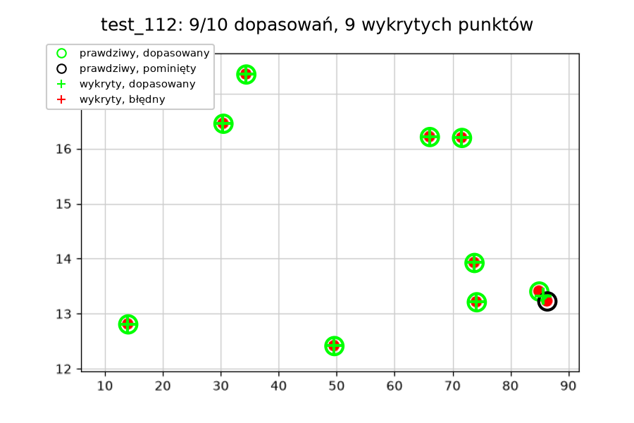

# Odczyt punktów z wykresu

To zadanie rekrutacyjne do sekcji AI/ML KN Solvro: program, który przyjmuje obraz
pojedynczego wykresu punktowego (jedna seria, widoczne markery, liniowe osie) i
zapisuje odczytane współrzędne punktów do CSV, razem z wizualizacją porównującą
wynik z obrazem wejściowym.

Pełna analiza krok po kroku (dane, kalibracja, detekcja, wyniki, wnioski) jest
w [notebooks/analysis.ipynb](notebooks/analysis.ipynb).

## Wyniki w skrócie

| split | obrazów | n_true | n_pred | n_matched | precision | recall | F1 | MAE_x | MAE_y |
|---|---|---|---|---|---|---|---|---|---|
| dev | 10 | 88 | 88 | 88 | 1.0000 | 1.0000 | 1.0000 | 0.0009 | 0.0015 |
| test | 20 | 194 | 192 | 192 | 1.0000 | 0.9897 | 0.9948 | 0.0010 | 0.0016 |

MAE po przeliczeniu na piksele wychodzi mniej niż jeden piksel. Jedyne błędy na
test to przypadki stykających się lub nakładających się punktów, które detekcja
zlewa w jedną plamę:



## Założenia i ograniczenia

- Dane syntetyczne z matplotlib (dev seedy 0 do 9, test 100 do 119), odtwarzam
  je przez `uv run python -m src.generate`. PlotQA trzeba pobierać w całych
  dużych archiwach, a własne dane dają od razu znane ground truth i kalibrację,
  ale wyniki na nich nie dowodzą skuteczności na wykresach z publikacji.
- Kalibracja pochodzi z generatora, więc w moim zbiorze nie ma pracy ręcznej.
  Na prawdziwym wykresie trzeba by podać dwa punkty odniesienia na każdej osi.
- Zakładam kolorowe markery oraz szare osie, siatkę i tekst. Wykresy z linią
  łączącą punkty albo z szarymi lub czarnymi markerami nie są obsługiwane.
- Dopasowanie zachłanne: dla każdego prawdziwego punktu biorę najbliższy
  niedopasowany wykryty punkt, trafienie liczy się, gdy błąd x i błąd y
  mieszczą się w 2% rozpiętości swojej osi.

## Jak uruchomić

```bash
uv sync
uv run python main.py
```

`main.py` uruchamia po kolei generowanie danych, detekcję i ewaluację.

Pojedyncze etapy:

```bash
uv run python -m src.generate
uv run python -m src.detect
uv run python -m src.evaluate
```

Notebook z pełnymi wynikami jest widoczny od razu na GitHubie. Lokalnie:

```bash
uv run jupyter lab notebooks/analysis.ipynb
```

## Struktura projektu

| Plik | Co robi |
|---|---|
| `main.py` | Uruchamia cały pipeline: generowanie danych, detekcja, ewaluacja. |
| `src/config.py` | Wspólne stałe: ścieżki, seedy dev/test, parametry generowania, progi detekcji, tolerancja dopasowania. |
| `src/generate.py` | Generuje syntetyczne wykresy i ich ground truth, rysuje sprawdzenie kalibracji. |
| `src/detect.py` | Detekcja punktów przez próg nasycenia i kontury, przeliczenie pikseli na wartości osi, zapis `predictions.csv`. |
| `src/evaluate.py` | Dopasowanie punktów, metryki, wizualizacje sukcesów i porażek. |
| `notebooks/analysis.ipynb` | Pokazuje dane, kalibrację i wyniki z zapisanych plików, detekcję na kilku przykładach. |
| `data/` | Wygenerowane obrazy i ground truth (CSV), commitowane do repo. |
| `results/` | Wyniki detekcji i ewaluacji (CSV) oraz wykresy (PNG), commitowane do repo. |
| `pyproject.toml`, `uv.lock` | Zależności. |
